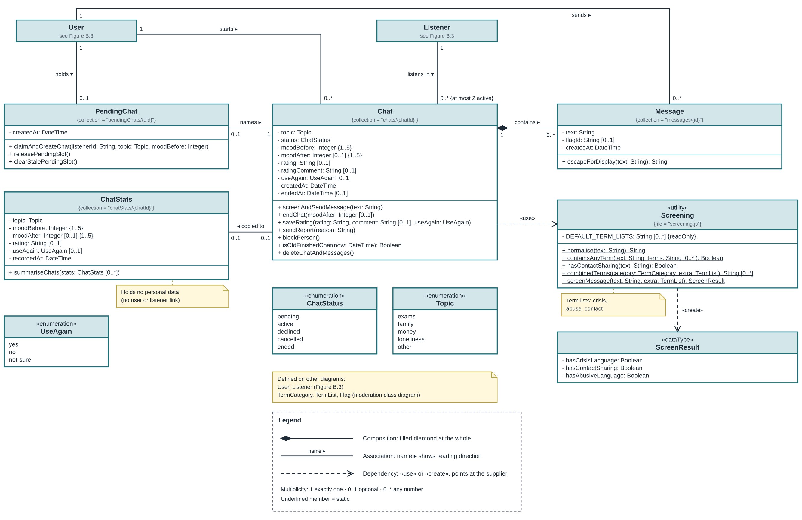
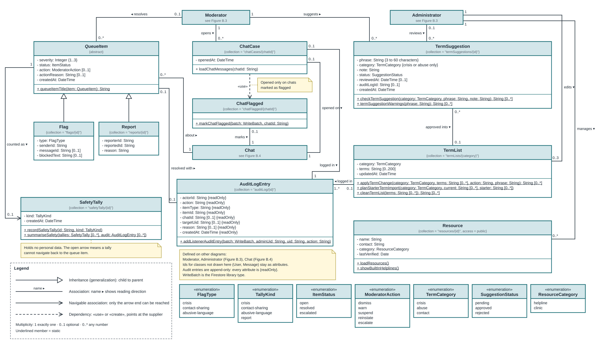
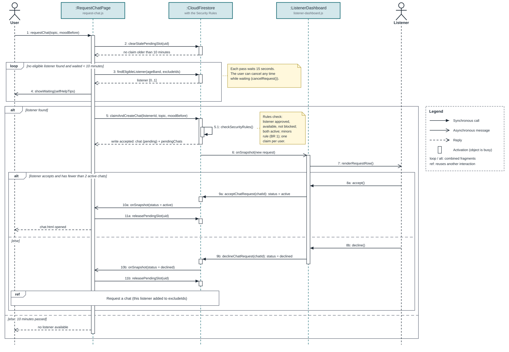

# Spill: Software Requirements Specification

**Version 3.1, 23 November 2026. Dianah Teta.**

This version describes Spill as it was built. Each requirement has a status: **Built** (done and tested), **Partly** (the note says what is missing) or **Not built**. The proposal (problem, research, method) is in version 2.0, `docs/Spill_Proposal_and_SRS.pdf`, and is not repeated here.

## Revision history

| Name | Date | Reason for changes | Version |
|---|---|---|---|
| Dianah Teta | 29 September 2026 | Initial version of the project proposal and SRS for Spill | 1.0 |
| Dianah Teta | 26 October 2026 | Added Appendix B with UML diagrams | 2.0 |
| Dianah Teta | 20 November 2026 | Updated to match the built app: status on every requirement, the real data model, new diagrams | 3.0 |
| Dianah Teta | 23 November 2026 | Last seven items built (FR 1.4, FR 3.1, FR 3.4, NFR 10, NFR 13, BR 7, Help page); class and sequence diagrams added | 3.1 |

---

## 1. Introduction

### 1.1 Purpose

This document specifies the software requirements for Spill, version 1.0 (minimum viable product): a free, anonymous peer-listener web app for young people aged 16 to 25 in Rwanda.

Out of scope for version 1.0: group spaces (Tier 2), users under 16, machine-learning moderation for real users, a native mobile app, phone verification, and Kinyarwanda or French screens.

### 1.2 Document conventions

- Requirement IDs use the prefixes FR (functional), NFR (non-functional) and BR (business rule), for example FR 4.2. They are the same as in version 2.0.
- Every requirement has a MoSCoW priority: Must, Should or Could.
- "User" means a young person seeking support. "Listener" means a vetted, trained volunteer.
- Names in `code style` are real files or Firestore collections.

### 1.3 Intended audience and reading suggestions

| Reader | Interest | Suggested sections |
|---|---|---|
| Lecturer and assessors | What was built and how well it meets the requirements | 1, 2, 4, 5 |
| Developers | Behaviour, data and rules | 3, 4, 6, Appendix B |
| Testers | What to check and the evidence | 4, 5 |
| Moderators and safeguarding advisers | Safety, escalation and resources | 2.3, FR 6, 5.2, 5.5 |

### 1.4 Product scope

Spill is a web app with three parts:

1. **Open resources (Tier 0):** verified helplines, clinics and self-help tips, and a "Need help now" button on every page. No account needed.
2. **Pseudonymous area (Tier 1):** mood check-ins with history, and one-to-one chat with a trained listener.
3. **Staff area:** pages for listeners, moderators and the administrator.

Every message is screened, and users can only ever reach listeners, never each other.

| Objective | How the app meets it |
|---|---|
| O1: register and start a chat in under five minutes | Sign-up is one page; a chat request is one button and one form. |
| O2: screen every message | Screened in the browser and again by the Security Rules. |
| O3: a moderator reviews every flag | One queue; every action needs a reason and is logged. |
| O4: mood before and after every chat | Asked in the request form and when ending the chat. |

### 1.5 References

- Spill proposal and SRS version 2.0: `docs/Spill_Proposal_and_SRS.pdf`.
- Republic of Rwanda (2021). Law No. 058/2021 relating to the protection of personal data and privacy.
- Evidence: `docs/test-report.md`, `docs/screening-report.md`, `docs/performance.md`, `docs/accessibility.md`, `docs/legal-privacy-checklist.md`, `docs/breach-procedure.md`, `docs/SRS_change_notes.md`.
- Code: https://github.com/Teta-Dianah/spill. Live app: https://spill-dev-01.web.app.

---

## 2. Overall description

### 2.1 Product perspective

Spill is a new, self-contained product. It does not connect to any other system. There is no application server: the pages run in the browser and talk directly to Firebase Hosting, Authentication and Cloud Firestore. Firestore Security Rules decide who may read or write each record and also screen messages. Figure B.10 shows the parts.

### 2.2 Product functions

- **Access and accounts:** sign up with an age band and a random pseudonym, agree to the privacy notice, sign in and out, delete the account.
- **Open resources:** helplines, clinics, self-help tips, a Help page and the crisis card.
- **Mood check-in:** a 1 to 5 mood with tags and a note, history and a monthly recap.
- **Listener chat:** request a chat, be matched, chat in real time, end and rate the chat.
- **Listener management:** apply, in-person checks, approval, training, availability.
- **Safety and moderation:** screening, crisis card, report, block, moderator queue, audit log.
- **Administration:** listeners, term lists, resources and anonymised statistics.

### 2.3 User classes and characteristics

| User class | Characteristics | Privileges and use | Priority |
|---|---|---|---|
| Visitor (Tier 0) | Anyone, no account, may be in distress | Helplines, clinics, self-help, Help page, crisis card | High |
| User (Tier 1) | Aged 16 to 25 (bands 16 to 17 and 18 to 25) | Mood check-ins, chats, report, block, delete own data | Most important |
| Listener | A user aged 21+, checked, approved and trained | Availability, accept or decline (at most 2 chats), chat | Most important |
| Moderator | Trained staff with safeguarding duties | Flag and report queue, logged cases, actions with a reason | High |
| Administrator | The system owner | Listeners, term lists, resources, statistics; cannot read chats | Medium |

### 2.4 Operating environment

- **Client:** any current browser on a phone or computer, from 320 px wide. Nothing to install.
- **Server side:** Firebase free Spark plan; Firestore in `africa-south1` (South Africa).
- **Projects:** `spill-dev-01` is the live site used for testing and the demo. `spill-pilot` has the same pages with separate data and is deployed but not in use (NFR 22).

### 2.5 Design and implementation constraints

- **Legal:** Law No. 058/2021 treats health data as sensitive (Art. 3) and needs a guardian's consent under 16 (Art. 9), so Spill excludes under-16s. See NFR 14.
- **Resources:** one developer, eight weeks, no budget: Spark plan only, no Cloud Functions.
- **Technology:** plain HTML, CSS and JavaScript with the Firebase SDK 12.19.0; real-time chat through Firestore listeners.
- **Moderation:** rule-based screening. An AI "model check" exists only as a prototype on the development site; it can add a flag but never blocks a message.
- **Security Rules can only allow or deny a write**, so the browser writes flags and the Rules refuse a crisis message without its flag.
- **Privacy:** no real names, phone numbers, location or ID documents.
- **Ethics:** peer support, not therapy. The class pilot invites adults only.

### 2.6 User documentation

- Privacy notice, terms of use and confidentiality statement: `privacy.html`.
- Help and FAQ page in plain language: `help.html`.
- Listener training and quiz: `listener-training.html`; code of conduct on the application form.
- README with setup, testing, deployment and a user guide; pilot runbook in `docs/pilot-runbook.md`.

### 2.7 Assumptions and dependencies

- Users have a smartphone or computer and internet access.
- Volunteers can be checked in person; Spill only records that each check was done.
- Helpline and clinic details are kept current by the administrator.
- The free Spark plan is enough for about 30 people at once.

---

## 3. External interface requirements

### 3.1 User interfaces

Mobile-first, calm colours and plain, non-clinical words ("Rough day", "Money stress"). A fixed "Need help now" button on every page. Errors are short and never blaming; sign-in errors do not reveal whether an email exists.

| Page | Who | Purpose |
|---|---|---|
| `index.html`, `privacy.html`, `help.html` | Anyone | Resources, privacy notice, Help page |
| `signup.html`, `signin.html` | Anyone | Sign up and sign in |
| `dashboard.html` | Signed in | Mood check-in, history, recap, open chat |
| `request-chat.html`, `chat.html` | User, listener | Request a chat; the chat |
| `listener-apply.html`, `listener-training.html`, `listener-dashboard.html` | Applicant, listener | Apply, train, accept requests |
| `staff.html`, `moderator-queue.html`, `moderator-case.html` | Moderator | Queue and cases |
| `admin-listeners.html`, `admin-terms.html`, `admin-resources.html`, `stats.html` | Admin | Listeners, terms, resources, statistics |

### 3.2 Hardware interfaces

None. Spill runs in the browser and uses no camera, microphone or location.

### 3.3 Software interfaces

| Component | Version | Purpose |
|---|---|---|
| Firebase JavaScript SDK (compat) | 12.19.0 | Authentication and Firestore from the pages |
| Firebase Hosting | n/a | Serves the pages |
| Firebase Authentication | n/a | Sign-in, password hashing, ID tokens |
| Cloud Firestore and Security Rules | Rules v2 | Data and every access decision |
| Firebase Local Emulator Suite | 15.32.1 | Local testing |
| Jest, ESLint | 30.5.2, 10.12.0 | Tests and code style |
| GitHub Actions | n/a | Tests on every push, uptime check |

### 3.4 Communications interfaces

All traffic uses HTTPS. Chats, requests and the moderator queue update live through Firestore listeners. There are no push, SMS or other message services; email is only used for the verification link.

---

## 4. Requirement specification

### 4.1 Stakeholder requirements

| Stakeholder | Requirement |
|---|---|
| Young people (users) | A private, quick, free and respectful way to talk; no exposure to strangers; clear help when things are serious. |
| Listeners | Clear rules, training and protection; can end unsafe chats; moderator support. |
| Moderators | A prioritised queue, the context to decide, a record of decisions. |
| Administrator | Control over listeners, lists and resources, with logged, limited access to private content. |
| Lecturer and assessors | Traceable, testable requirements that fit an 8-week project. |
| Health system (indirect) | Correct referral details for helplines and clinics. |

### 4.2 Functional requirements

Priority is at the end of each description.

#### FR 1 Access and accounts

| Req ID | Requirement | Description | Status |
|---|---|---|---|
| FR 1.1 | Register account | Register with email, password and age band (16 to 17 or 18 to 25); refuse under 16. (Must) | Built: "Under 16" shows the helplines and makes no account. |
| FR 1.2 | Assign pseudonym | A random display name used everywhere instead of a real identity. (Must) | Built |
| FR 1.3 | Capture consent | Show the privacy and "not therapy" notices and require agreement before the account is made. (Must) | Built: version and time are saved. |
| FR 1.4 | Sign in and out | Sign in with email and password; end the session on sign-out or after inactivity. (Must) | Built: signed out after 30 minutes away, not during a chat. |
| FR 1.5 | Delete account | Delete the account and personal data; keep data tied to an open safety case. (Should) | Built: chats and flags are kept with a random ID only. |
| FR 1.6 | First-time question | Ask once whether this is the first time seeking support (hypothesis H1). (Should) | Built |
| FR 1.7 | Verify email | Send a verification link. (Could) | Built |

#### FR 2 Open resources (Tier 0)

| Req ID | Requirement | Description | Status |
|---|---|---|---|
| FR 2.1 | Display helplines | Helplines with number and a "last verified" date, without an account. (Must) | Built |
| FR 2.2 | Display clinics | Mental health facilities with contact details. (Must) | Built |
| FR 2.3 | Self-help content | Short guides such as breathing and grounding. (Should) | Built |
| FR 2.4 | Need help now | A fixed button on every page opens the crisis card in one tap. (Must) | Built: on all 18 pages, works offline. |

#### FR 3 Mood check-in

| Req ID | Requirement | Description | Status |
|---|---|---|---|
| FR 3.1 | Record mood | Mood on a 1 to 5 scale with optional tags and a short note. (Must) | Built: eight tags, such as "Rough day". |
| FR 3.2 | Mood before and after chat | Record mood before and after a chat and store both with it. (Must) | Built |
| FR 3.3 | Mood history | The user's own history as a list and a simple chart. (Should) | Built |
| FR 3.4 | Monthly recap | A private monthly summary. (Could) | Built |

#### FR 4 Listener chat

| Req ID | Requirement | Description | Status |
|---|---|---|---|
| FR 4.1 | Request a chat | Choose a topic and request a chat. (Must) | Built: one request at a time. |
| FR 4.2 | Match with a listener | Match with an available approved listener; 16 to 17 year olds only with cleared listeners; show the wait status otherwise. (Must) | Built: retries every 15 s for 10 minutes. |
| FR 4.3 | Exchange messages | Send and receive messages in real time. (Must) | Built |
| FR 4.4 | User-initiated only | Only a user may start a chat. (Must) | Built |
| FR 4.5 | End chat | Either person can end a chat at any time without a reason. (Must) | Built |
| FR 4.6 | Rate chat | Optional helpful or not rating and comment. (Should) | Built: plus "Would you use Spill again?" |
| FR 4.7 | Restrict visibility | Chat content visible only to its two people and, through a case, to moderators. (Must) | Built |

#### FR 5 Listener management

| Req ID | Requirement | Description | Status |
|---|---|---|---|
| FR 5.1 | Apply as listener | An application form with the details for offline vetting. (Must) | Built: gives a reference code. |
| FR 5.2 | Approve listeners | Approve or reject after offline checks, and mark who is cleared for minors. (Must) | Built: four checks (interview added). |
| FR 5.3 | Training and quiz | Training and a quiz before accepting chats. (Should) | Built |
| FR 5.4 | Set availability | Mark oneself available or unavailable. (Must) | Built |
| FR 5.5 | Accept or decline | Accept or decline a request, at most two chats at once. (Should) | Built |
| FR 5.6 | Listener dashboard | The listener's own activity summary. (Could) | Built |

#### FR 6 Safety and moderation

| Req ID | Requirement | Description | Status |
|---|---|---|---|
| FR 6.1 | Screen every message | Normalise each message and check it against patterns and term lists before delivery. (Must) | Built: tested on 151 labelled messages. |
| FR 6.2 | Crisis language | Deliver the message, show the crisis card and save a high-priority flag in the same write. (Must) | Built |
| FR 6.3 | Block contact sharing | Reject phone numbers, emails, links and handles, warn the sender, save a blocked-attempt flag. (Must) | Built |
| FR 6.4 | Abusive language | Flag insults and threats for review. (Should) | Built |
| FR 6.5 | Report | Report a chat or the other person with a reason. (Must) | Built |
| FR 6.6 | Block a person | Block the other person so they are not matched again. (Must) | Built |
| FR 6.7 | Moderator queue | Flags and reports ordered by severity and age. (Must) | Built |
| FR 6.8 | Moderator actions | Dismiss, warn, suspend, reinstate or escalate with a recorded reason. (Must) | Built |
| FR 6.9 | Audit log | Log every staff action and every access to chat content. (Should) | Built |
| FR 6.10 | Peer support notice | Show on chat screens that this is peer support, not therapy. (Must) | Built |

#### FR 7 Administration

| Req ID | Requirement | Description | Status |
|---|---|---|---|
| FR 7.1 | Manage term lists | Edit the crisis, contact and abuse lists without redeploying. (Should) | Built: moderators can suggest terms. |
| FR 7.2 | Manage resources | Add, edit and remove helplines and clinics with a last-verified date. (Must) | Built |
| FR 7.3 | Anonymised statistics | Counts of chats, mood change and flags, without personal data. (Should) | Built: groups under 5 hidden. |
| FR 7.4 | Role-based access | Enforce access by role in the Security Rules; a user reads only their own chats. (Must) | Built |

---

## 5. Other non-functional requirements

Evidence for each is in `docs/`.

### 5.1 Performance requirements

| Type | Req ID | Description | Status |
|---|---|---|---|
| Performance | NFR 1 | A page loads in 3 seconds or less on a typical mobile connection. (Should) | Partly: about 3 s on slow 4G; helplines up to 4.8 s live. |
| Performance | NFR 2 | A message appears to the other person within 2 seconds. (Must) | Met: 0.2 to 0.6 s on the emulator. |
| Scalability | NFR 3 | At least 30 people at once within the free plan. (Should) | Met in a 30-person test. |

### 5.2 Safety requirements

| Type | Req ID | Description | Status |
|---|---|---|---|
| Safety | NFR 4 | Crisis flags reach the moderator queue within 1 minute. (Must) | Met |
| Safety | NFR 5 | The crisis card is one tap from any page. (Must) | Met |

### 5.3 Security requirements

| Type | Req ID | Description | Status |
|---|---|---|---|
| Security | NFR 6 | Passwords handled and hashed by Firebase, at least 8 characters. (Must) | Met |
| Security | NFR 7 | All traffic uses HTTPS. (Must) | Met |
| Security | NFR 8 | Every request for private data carries a valid ID token; Tier 0 is public and read-only. (Must) | Met |
| Security | NFR 9 | No raw query strings; all output escaped. (Must) | Met |
| Security | NFR 10 | Sign-in limited by Firebase; message sending throttled by the Rules. (Must) | Met: one message every 2 seconds. |
| Privacy | NFR 11 | No real names, phone numbers, location or ID documents; email for sign-in only. (Must) | Met |
| Privacy | NFR 12 | Messages encrypted at rest, readable only by participants and through a case. (Should) | Met |
| Privacy | NFR 13 | Chats kept for a limited time (90 days). (Should) | Met: removed when either person next opens their dashboard. |
| Legal | NFR 14 | Before launch: exclude under-16s, privacy notice, 48-hour breach procedure, assess NCSA registration and a DPO, data in Rwanda or authorised. (Must) | Done for the class pilot; see `legal-privacy-checklist.md`. |

### 5.4 Software quality attributes

Safety and privacy come first, then usability, then performance.

| Type | Req ID | Description | Status |
|---|---|---|---|
| Usability | NFR 15 | Plain, non-clinical English. (Must) | Met |
| Usability | NFR 16 | WCAG 2.1 AA contrast, keyboard use, 44 px tap targets. (Should) | Met in automated checks |
| Usability | NFR 17 | A signed-in user reaches a chat request in three steps or fewer. (Must) | Met |
| Reliability | NFR 18 | Messages saved before delivery; 95% availability in the pilot. (Should) | Met |
| Auditability | NFR 19 | Staff actions and content access logged; logs not editable. (Should) | Met |
| Maintainability | NFR 20 | Screening rules documented; ESLint; README for setup and deployment. (Must) | Met |
| Testability | NFR 21 | Tests on every push with the emulator; screening tested on 40+ labelled messages. (Must) | Met: 803 tests, 151 messages. |
| Portability | NFR 22 | Config kept out of the code; separate development and pilot projects. (Should) | Met |

### 5.5 Business rules

| Rule | Description | Status |
|---|---|---|
| BR 1 | 16 to 17 year olds are matched only with listeners who are 21+, approved and cleared for minors. | Enforced |
| BR 2 | A listener must be approved and trained before accepting chats. | Enforced |
| BR 3 | Moderators open chat content only through a case from a flag or report; every access is logged. | Enforced |
| BR 4 | Administrators and developers cannot read chats outside moderation. | Enforced |
| BR 5 | Either person can end a chat or block the other at any time without a reason. | Enforced |
| BR 6 | Chats are confidential except where there is serious risk of harm; users are told at sign-up. | Enforced |
| BR 7 | A suspended account cannot chat until a moderator reinstates it. | Enforced |
| BR 8 | Tier 0 resources are always available without an account. | Enforced |

---

## 6. Data model

Version 2.0 listed eight collections; the built app has eighteen.

| Collection | Holds | Who can read it |
|---|---|---|
| `accounts` | Pseudonym, age band, role, status, consent | Owner, moderators, admins |
| `moods` | Mood check-ins | Owner |
| `listeners` | Approval, availability, training | Signed in |
| `listenerApplications` | Application answers and checks | Applicant, admins |
| `chats` | Chat details and moods | The two people; moderator with a case |
| `pendingChats` | The one request a user has waiting | Owner |
| `messages` | Message text | The two people; moderator with a case |
| `sendTimes` | Time of the last message sent | Owner |
| `flags`, `reports` | Safety flags and reports | Moderators |
| `chatFlagged`, `chatCases` | Markers: a chat was flagged; a case was opened | Moderators |
| `auditLog` | Every staff action; never edited | Moderators, admins |
| `resources` | Helplines and clinics | Everyone |
| `termLists`, `termSuggestions` | Screening terms and suggested terms | Signed in; admins |
| `chatStats`, `safetyTally` | Anonymised copies for statistics | Admins |

---

## Appendix A: Glossary

| Term | Definition |
|---|---|
| FR / NFR / BR | Functional requirement, non-functional requirement, business rule. |
| MoSCoW | Must, Should, Could: the priority scale. |
| MVP | Minimum viable product: version 1.0. |
| Tier 0 / 1 / 2 | No account; a pseudonymous account; group spaces (not built). |
| Firestore | Firebase's real-time database. |
| Security Rules | Server-side rules that decide every read and write. |
| ID token | The signed pass Firebase gives after sign-in. |
| Emulator Suite | Local Firebase used for tests. |
| Crisis card | The "Need help now" panel of helplines and clinics. |
| Case | A moderator's logged access to a flagged chat. |
| Spark plan | Firebase's free plan. |

---

## Appendix B: UML diagrams

The editable files are in [`docs/diagrams/`](diagrams/). Each diagram has its own legend.

### 1. Use case diagrams

**Figure B.1: Use case diagram, resources, account and mood**

**Description & Flow:** what a person can do before and after registering.

- **Actors:** the Visitor has no account. The User is a registered young person aged 16 to 25, and generalises the Visitor, so a User can do everything a Visitor can.
- **Base use cases:** the Visitor reads self-help tips, views helplines and clinics, opens the crisis card ("Need help now"), reads the privacy notice and terms, reads the Help page and registers an account. The User also signs in and out, records a mood check-in, views mood history and the monthly recap, and deletes the account.
- **Note:** deleting the account also removes the user's check-ins and listener records (FR 1.5).

| Relationship | Type | Meaning |
|---|---|---|
| Open the crisis card to View helplines and clinics | «include» | The card always shows the helplines. |
| Register an account to Agree to the privacy notice | «include» | The notice version and time are recorded. |
| Register an account to Get a random pseudonym | «include» | No real name is ever asked for. |
| Register an account to Answer the first-time help-seeking question | «include» | Asked once at sign-up (FR 1.6). |
| Register an account to Get a verification email | «include» | Sent after the account is made (FR 1.7). |
| Reject under-16 sign-up to Register an account | «extend» | Condition {age < 16}: no account is created. |
| Add topic tags to Record a mood check-in | «extend» | Condition {user chooses to tag}, for example Rough day. |

**Figure B.2: Use case diagram, chat, safety and staff work**

**Description & Flow:** how users and listeners chat safely, and what staff do.

- **Actors:** User, Listener, Moderator, Administrator.
- **Base use cases:**
  - User: apply to be a listener, request a chat, exchange messages, report or block the other person, end the chat.
  - Listener: set availability, accept or decline a chat request, exchange messages, report, block, end the chat.
  - Moderator: review the flag and report queue, open a case on a chat, take a moderation action, suggest a screening term.
  - Administrator: review listener applications, manage the term lists, approve or reject suggested terms, manage helplines and clinics, view anonymised statistics.
- **Notes:** before the chat the user picks a topic and rates their mood. Every moderation action needs a reason, and opening a case and every action are logged. Reviewing an application means running the checks, then approving or rejecting.

| Relationship | Type | Meaning |
|---|---|---|
| Apply to be a listener to Pass the training quiz | «include» | No one listens before passing the quiz (BR 2). |
| Request a chat to Match with an eligible listener | «include» | Every request goes through matching (BR 1). |
| Exchange messages to Screen every message | «include» | Every message is screened (FR 6.1). |
| Trigger crisis support to Screen every message | «extend» | Condition {message matches crisis terms}: shows the crisis card and saves a crisis flag. |
| Block a contact-sharing message to Screen every message | «extend» | Condition {message has contact details}. |
| Answer the after-chat questions to End the chat | «extend» | Condition {user chooses to answer}. |

### 2. Class diagrams

**Description & Flow:** the main data and behaviour of Spill as classes. Each class lists its attributes (-, private) and operations (+, public), and names the Firestore collection it is saved in. Abstract classes are in italics and static operations are underlined. A class drawn on another diagram is shown by name only, with "see Figure B.x".

**Figure B.3: Class diagram, people and roles**

- **Classes:** Account (abstract) is extended by Moderator, User and Administrator; Listener extends User. MoodCheckIn, SendTime and ListenerApplication hold each person's data. Checks is a data type inside ListenerApplication. The enumerations are AgeBand, AccountStatus, ApplicationStatus, HoursBand and MoodTag.
- **Inputs and Outputs:** inputs are sign-up details, mood scores, notes, tags and application answers. Outputs are the stored account, check-ins, the listener record and the application.
- **Relationships:**

| Relationship | Type | Meaning |
|---|---|---|
| Moderator, User, Administrator to Account | Inheritance | Every role is an account and inherits the pseudonym, status and sign-in. |
| Listener to User | Inheritance | A listener is a user who was approved. |
| User records MoodCheckIn (1 to 0..*) | Composition | Check-ins are deleted with the account (FR 1.5). |
| User has SendTime (1 to 0..1) | Composition | The last-message time, so sends are at least 2 seconds apart (NFR 10). |
| User submits ListenerApplication (1 to 0..1) | Association | One application per person (FR 5.1). |
| Listener approved from ListenerApplication (0..1 to 1) | Association | The listener record is made when the application is approved; the private answers stay apart from it. |
| Administrator reviews ListenerApplication (0..* to 0..*) | Association | Any admin can review any application (FR 5.2). |
| User blocks User (0..* blocker to 0..* blocked) | Association | Either person can block the other (FR 6.6, BR 5). |

**Figure B.4: Class diagram, chats and messages**

- **Classes:** Chat, Message, PendingChat and ChatStats, with Screening (a utility class) and ScreenResult (a data type). The enumerations are ChatStatus, Topic and UseAgain. User and Listener are shown by name only (Figure B.3).
- **Inputs and Outputs:** inputs are the topic, moods, messages and after-chat answers. Outputs are the chat, its messages, the screening result and the anonymised copy.
- **Relationships:**

| Relationship | Type | Meaning |
|---|---|---|
| User starts Chat (1 to 0..*) | Association | Only users start chats (FR 4.1). |
| Listener listens in Chat (1 to 0..*, at most 2 active) | Association | A listener has at most 2 active chats (FR 5.5). |
| User holds PendingChat (1 to 0..1) | Association | One request at a time (FR 4.1). |
| PendingChat names Chat (0..1 to 1) | Association | The marker points at the one waiting chat. |
| User sends Message (1 to 0..*) | Association | Each message has one sender. |
| Chat contains Message (1 to 0..*) | Composition | Messages exist only inside their chat and are deleted with it (NFR 13). |
| Chat copied to ChatStats (0..1 to 0..1) | Association | The anonymised copy, with no personal data, kept after the chat is deleted (FR 7.3). |
| Chat «use» Screening | Dependency | Every message is screened before it is sent (FR 6.1). |
| Screening «create» ScreenResult | Dependency | The yes or no answers (crisis, contact, abuse) that decide what happens next. |

**Figure B.5: Class diagram, safety and administration**

- **Classes:** QueueItem (abstract) with Flag and Report; ChatCase, ChatFlagged, AuditLogEntry, SafetyTally, TermSuggestion, TermList and Resource. The enumerations are FlagType, TallyKind, ItemStatus, ModeratorAction, TermCategory, SuggestionStatus and ResourceCategory. Moderator, Administrator and Chat are shown by name only.
- **Inputs and Outputs:** inputs are flags, reports, moderator actions with reasons, suggested terms and resources. Outputs are resolved queue items, cases, audit entries, term lists and statistics counts.
- **Relationships:**

| Relationship | Type | Meaning |
|---|---|---|
| Flag, Report to QueueItem | Inheritance | Both appear in one moderator queue with a severity and status. |
| Moderator resolves QueueItem (0..1 to 0..*) | Association | With an action and a reason (FR 6.8). |
| QueueItem about Chat (0..* to 1) | Association | Each flag or report concerns one chat. |
| QueueItem resolved with AuditLogEntry (0..1 to 0..1) | Association | The action and its log entry are saved together (FR 6.9). |
| QueueItem counted as SafetyTally (1 to 0..1) | Navigable association | A count with no content, for statistics (FR 7.3). The tally cannot lead back to the item. |
| Moderator opens ChatCase (1 to 0..*) | Association | The only way into a chat's content (BR 3). |
| ChatCase «use» ChatFlagged | Dependency | A case can only be opened on a chat marked as flagged. |
| ChatFlagged marks Chat (0..1 to 1) | Association | Something was raised about this chat. |
| ChatCase opened on Chat (0..1 to 1) | Association | One case per chat. |
| ChatCase logged in AuditLogEntry (0..1 to 1) | Association | Opening a case is always logged. |
| Moderator suggests TermSuggestion (1 to 0..*) | Association | A crisis or abuse phrase for a term list. |
| Administrator reviews TermSuggestion (0..1 to 0..*) | Association | Approve or reject, logged. |
| TermSuggestion approved into TermList (0..* to 0..1) | Association | Nothing reaches a list without an admin. |
| Administrator edits TermList (1 to 0..3) | Association | The crisis, abuse and contact lists (FR 7.1). |
| TermList logged in AuditLogEntry (0..1 to 1..*) | Association | Every change has its own log entry. |
| Administrator manages Resource (1 to 0..*) | Association | Helplines and clinics, readable by anyone (FR 7.2, BR 8). |

### 3. Sequence diagrams

**Description & Flow:** the order of messages between parts in the two main flows. Time runs from top to bottom.

**Figure B.6: Sequence diagram, request a chat and get matched**

- **Lifelines:** User, :RequestChatPage, :CloudFirestore (with the Security Rules), :ListenerDashboard and Listener.
- The user requests a chat with a topic and a mood. The page first clears any pending marker older than 10 minutes.
- **loop** while no eligible listener is found and less than 10 minutes have passed: the page looks for a listener every 15 seconds and shows the wait status with self-help tips. The user can cancel at any time.
- **alt** listener found: the page creates the pending chat and the one-request marker in one write. The Rules check the listener is approved, available and not blocked, both accounts are active, the minors rule (BR 1) and one claim per user. The listener's dashboard shows the request.
  - **alt** the listener accepts and has fewer than 2 active chats: the chat becomes active, the page releases the marker and opens the chat.
  - **else** the listener declines: the chat is marked declined, the marker is released and the request starts again without this listener (**ref**).
- **else** 10 minutes passed: the user sees that no listener is available.

**Figure B.7: Sequence diagram, send a message with screening**

- **Lifelines:** Sender (any user or listener in the chat), sender:ChatPage, :Screening, :CloudFirestore and receiver:ChatPage.
- The page waits for the 2-second gap, then screens the text and gets a ScreenResult.
- **alt**, one branch runs:
  - contact sharing: a warning is shown, and only a blocked-attempt flag and the chatFlagged marker are saved (no message);
  - crisis wording: the message, a crisis flag, the chatFlagged marker and the send time are saved together, then the crisis card is shown;
  - abusive words: the message, an abuse flag and the send time are saved;
  - else: the message and the send time are saved.
- **opt** a message was saved: the other person's page receives it live and shows it.
- The Rules refuse contact details, a crisis message without its flag, a second message within 2 seconds and anything from a suspended account, whatever the page does.

### 4. Activity diagrams

**Figure B.8: Activity diagram, register and get matched**

**Description & Flow:** from first visit to an open chat, in three swimlanes: User, System (the browser and the Security Rules) and Listener.

- **Inputs and Outputs:** age band, email and password, first-time answer, consent, mood and topic; a new account and an active chat.
- **Flow:**
  - Under 16: a kind note and the helplines are shown, and no account is made.
  - 16 or over: the user signs up, the system creates the account with a random pseudonym and sends a verification email. The Rules check the age band, consent time and fields.
  - On the dashboard the user can record a mood check-in, then chooses a topic and a mood before (1 to 5).
  - In an interruptible region, the system looks for an eligible listener (BR 1). If none is found the user sees the wait status, and after 15 seconds the search runs again. "User cancels" ends the flow at any time. After 10 minutes the user sees "nobody is free right now, try again later".
  - When a listener is found, the pending chat and the marker are made in one write (FR 4.1) and the listener sees the request. On decline, the marker is released and the search continues without that listener (connector A). On accept, the chat becomes active, and both chat pages open in parallel (fork and join).

**Figure B.9: Activity diagram, chat, screening and moderation**

**Description & Flow:** how a chat works and how safety is handled, in three swimlanes: Chat participant (user or listener), System and Moderator.

- **Inputs and Outputs:** messages, mood after, after-chat answers, reports and moderator actions; delivered messages, flags, the anonymised copy and audit entries.
- **Flow:**
  - In an interruptible region, the participant sends a message. The system waits for the 2-second gap (NFR 10) and screens it against the term lists and patterns.
  - Contact details: the message is blocked, the sender is warned and a blocked-attempt flag is saved (severity 2, or 3 for a listener). If it also has crisis wording, a crisis flag is saved and the crisis card shows.
  - Crisis wording: the message and a crisis flag (severity 3) are saved in one write, and the crisis card shows.
  - Abusive words: the message is delivered and an abuse flag (severity 1) is saved. Otherwise the message is delivered.
  - This repeats until either person ends the chat or blocks the other. A suspended account cannot send (BR 7).
  - When the chat closes, a user gives a mood after and may answer the after-chat questions; the anonymised copy is saved.
  - A participant may report the other person. The report (severity 2) and the flagged marker go to the moderation queue with the flags.
  - The moderator opens the queue (most serious first), opens a logged case, reads the chat and chooses an action with a reason. The system updates the flag or report and writes the audit entry in one write.
- **Note:** on the development site only, an optional AI check (a prototype) can add a crisis or abuse flag after a message is sent. It never blocks a message.

### 5. Deployment diagram

**Figure B.10: Deployment diagram of the Spill web application**

**Description & Flow:** where each part of Spill runs and how the parts connect.

- **Nodes:**
  - the user's device (a phone or computer) with a web browser, which runs the pages for every role;
  - the development Firebase project (spill-dev-01, Spark plan): Hosting, Authentication, Cloud Firestore (africa-south1, 18 collections) and Firebase AI Logic (the optional prototype, off unless switched on);
  - the pilot Firebase project (spill-pilot): the same pages and rules with separate data, deployed on 19 November 2026 and not used yet;
  - the developer's computer with the source code and the Firebase Local Emulator Suite;
  - GitHub with the repository and GitHub Actions.
- **Artifacts:** the 18 pages, CSS, JavaScript and fonts on Hosting; the Security Rules on Firestore; the source code, rules, tests and config files (kept out of Git) on the developer's computer.
- **Connections:**

| Connection | Type | Meaning |
|---|---|---|
| Web browser to Firebase Hosting | «HTTPS» | Loads the pages. |
| Web browser to Firebase Authentication | «HTTPS» | Sign-up and sign-in, ID tokens. |
| Web browser to Cloud Firestore | «HTTPS» | All data, live through real-time listeners, checked by the Rules. No application server. |
| Web browser to Firebase AI Logic | «HTTPS», optional | The model check prototype, development only. |
| Developer's computer to GitHub | «HTTPS» | git push; Actions runs lint, unit and rules tests on every push. |
| GitHub Actions to the development project | «HTTPS» | Uptime check of the live site every 3 hours. |
| Source code to the development project | «deploy» | npm run deploy:dev: tests, lint, deploy, then a live check. |
| Source code to the pilot project | «deploy» | Same pages and rules, separate data. |

---

## Appendix C: What changed from version 2.0

| Area | Version 2.0 | Version 3.1 |
|---|---|---|
| Collections | 8 | 18 |
| Under-16s | Registration refused | "Under 16" choice that makes no account |
| Listener checks | Three | Four (interview added); listeners 21+ |
| After a chat | Helpful or not | Plus "Would you use Spill again?" |
| Term lists | Admin edits | Plus moderator suggestions |
| Screening | Rule-based | Rule-based, plus an AI prototype on the development site |
| 90-day chat removal | Scheduled clean-up | Done when a person opens their dashboard (no scheduled jobs on the free plan) |

Reasons for each change are in `docs/SRS_change_notes.md`.
