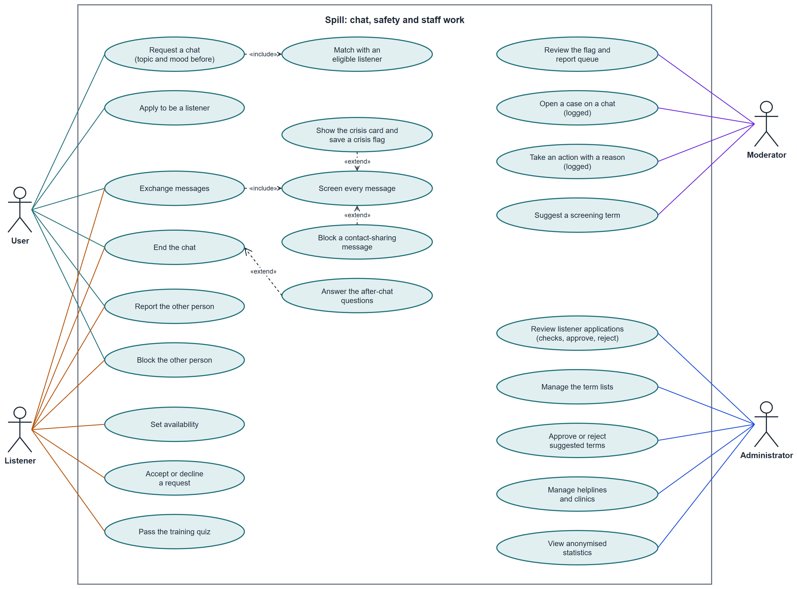
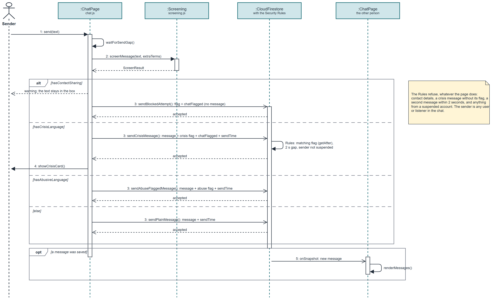

# Spill: Software Requirements Specification

**Version 3.1, 23 November 2026. Dianah Teta.**

This version describes Spill **as it was built**. Version 2.0 (`docs/Spill_Proposal_and_SRS.pdf`) was written before the code, so some of it no longer matches. Here, every requirement carries a status:

| Status | Meaning |
|---|---|
| **Built** | The app does this, and a test or a check shows it. |
| **Partly built** | Some of it works; the "How it works now" column says what is missing. |
| **Not built** | The app does not do this yet. |

The proposal part of the PDF (problem, research, method) is unchanged and is not repeated here.

## Revision history

| Version | Date | What changed |
|---|---|---|
| 1.0 | Sprint 0 | First draft with the proposal. |
| 2.0 | Before Sprint 1 | Full SRS with the UML diagrams (the PDF). |
| 3.0 | 20 November 2026 | Rewritten to match the built app: statuses on every requirement, the real data model, the listener vetting steps, the after-chat questions, the statistics, the model check prototype, the legal decisions for the class pilot, and new diagrams drawn from the code. |
| 3.1 | 23 November 2026 | The last seven items are built: sign-out after 30 minutes away (FR 1.4), mood tags (FR 3.1), the monthly recap (FR 3.4), one message every 2 seconds (NFR 10), chats removed after 90 days (NFR 13), suspended accounts cannot send (BR 7) and the Help page. A new `sendTimes` collection. Full UML set: class diagrams with operations, and sequence diagrams. |

---

## 1. Introduction

### 1.1 Purpose

This document specifies Spill version 1.0, a free, anonymous peer-listener web app for young people aged 16 to 25 in Rwanda. It covers the whole product as built: the public pages, the user's pages, the listener, moderator and administrator pages, the database rules, and how it is tested and deployed.

Outside the scope of version 1.0, and not built: group community spaces (Tier 2), users under 16, machine-learning moderation for real users, a native mobile app, phone verification, and Kinyarwanda or French screens.

### 1.2 Document conventions

- Requirement IDs: **FR** (functional), **NFR** (non-functional) and **BR** (business rule), for example FR 4.2. The IDs are the same as in version 2.0, so the code, tests and issues still point at the right requirement.
- Each requirement keeps its MoSCoW priority: **Must**, **Should** or **Could**.
- "User" means a young person seeking support. "Listener" means a vetted, trained volunteer. Terms in Appendix A start with a capital letter.
- Access levels: **Tier 0** is open to anyone with no account. **Tier 1** is a signed-in pseudonymous account. Tier 2 (group spaces) is not built.
- Collection names in `code style` are the real Firestore collections.

### 1.3 Intended audience

| Reader | Interest | Suggested sections |
|---|---|---|
| Lecturer and assessors | What was built, and how well it meets the requirements | 1, 2, 4, 5 |
| Developer | Exact behaviour, data and rules | 3, 4, 6, Appendix B |
| Testers | What to check, and the evidence already gathered | 4, 5 |
| Moderators and safeguarding advisers | Safety, escalation and resources | 2.3, FR 6, 5.2, 5.5 |

### 1.4 Product scope

Spill has three parts:

1. **Open resources (Tier 0):** helplines, clinics and self-help tips, and a "Need help now" button on every page. No account is needed.
2. **A pseudonymous area (Tier 1):** mood check-ins with a history, and one-to-one chat with a trained listener.
3. **A staff area:** pages for listeners, moderators and the administrator.

Every message is screened. Users can only ever reach listeners, never each other.

Version 2.0 set four objectives. How the built app supports each:

| Objective | How the app supports it |
|---|---|
| O1: register and start a chat in under five minutes | Sign-up is one page. From the dashboard, a chat request is one button and one form (NFR 17). |
| O2: screen every message for crisis language and contact-sharing | Every message is screened in the browser, and again by the Security Rules (FR 6.1 to 6.3). |
| O3: a moderator reviews every flag | Every flag and report goes to one queue, and each action needs a reason and is logged (FR 6.7 to 6.9). |
| O4: mood before and after every chat | The mood before is part of the request form. The user gives the mood after to end the chat (FR 3.2). |

**Where it runs.** The app is live at https://spill-dev-01.web.app, the development project. All testing happens there, including the teacher's. A second project, `spill-pilot`, was deployed on 19 November 2026 with the same pages and rules, but is not in use (see 2.4).

### 1.5 References

- Version 2.0: `docs/Spill_Proposal_and_SRS.pdf`, including the proposal and its references.
- Republic of Rwanda (2021). Law No. 058/2021 of 13/10/2021 relating to the protection of personal data and privacy.
- Evidence in this repository: `docs/test-report.md`, `docs/screening-report.md`, `docs/performance.md`, `docs/accessibility.md`, `docs/legal-privacy-checklist.md`, `docs/breach-procedure.md`, `docs/SRS_change_notes.md`.
- Code: https://github.com/Teta-Dianah/spill. Live app: https://spill-dev-01.web.app.

---

## 2. Overall description

### 2.1 Product perspective

Spill is a new, self-contained web app. It does not connect to any other system. It lists public helplines and clinics that an administrator keeps up to date, but it does not exchange data with them.

There is **no application server**. The pages run in the person's browser and talk directly to three Firebase services: Hosting (the files), Authentication (sign-in) and Cloud Firestore (the data). Firestore Security Rules decide who may read or write each record, and they also screen messages. Matching a user to a listener happens in the user's browser, because the free Spark plan has no server functions. Figure B.10 shows the parts.

### 2.2 Product functions

- **Access and accounts:** sign up with an age band (the app gives a random pseudonym), agree to the privacy notice, sign in and out, be signed out after 30 minutes away, delete the account.
- **Open resources:** helplines, clinics and self-help tips, a Help page of questions and answers, plus "Need help now" on every page.
- **Mood check-in:** a 1 to 5 mood with optional topic tags and an optional note, a history, and a private monthly recap.
- **Listener chat:** choose a topic and a mood, be matched with an eligible listener, chat in real time, end the chat, and answer the after-chat questions.
- **Becoming a listener:** apply, pass four in-person checks, be approved, pass the training quiz, set availability, accept or decline requests.
- **Safety and moderation:** screen every message, show the crisis card, block contact-sharing, flag abusive words, report and block, a moderator queue with cases, actions and an audit log.
- **Administration:** listener applications, screening term lists (with suggestions from moderators), helplines and clinics, and anonymised statistics.

### 2.3 User classes and characteristics

| Class | Who | What they can do | Priority |
|---|---|---|---|
| Visitor (Tier 0) | Anyone, no account; may be in distress | Read helplines, clinics, self-help tips and the privacy notice; open the crisis card | High |
| User (Tier 1) | Aged 16 to 25, in two bands: 16 to 17 and 18 to 25 | Mood check-ins, chat requests, report, block, apply to be a listener, delete their own data | Most important |
| Listener | A user aged 21 or over who applied, passed the in-person checks, was approved and passed training | Set availability, accept or decline requests (at most 2 active chats), chat, report, block. Cannot start a chat. | Most important |
| Moderator | Trained staff or volunteer with safeguarding duties | Work the flag and report queue, open cases (logged), act with a reason, suggest screening terms | High |
| Administrator | The system owner | Approve or reject listeners, manage term lists and resources, review suggested terms, see anonymised statistics. Cannot read chats or flags. | Medium |

Roles are stored on the account (`role`: user, moderator or admin). A listener is a user with an approved `listeners/{uid}` record. Moderator and admin roles are set by hand in the Firebase console; sign-up only ever makes an ordinary user.

### 2.4 Operating environment

- **Client:** any current browser (Chrome, Edge, Firefox, Safari) on a phone or computer, from 320 px wide. Nothing to install.
- **Hosting and data:** Firebase on the free Spark plan. Firestore is in `africa-south1` (Johannesburg, South Africa) in both projects.
- **Two projects (NFR 22):**
  - `spill-dev-01` is the live site used for all testing and demos.
  - `spill-pilot` has the same pages and rules with separate data. It was deployed on 19 November 2026 and is not in use, because the class pilot (the teacher's testing) happens on the development site.
- **Config:** each project's Firebase config is kept in `config/` on the developer's computer and never committed.

### 2.5 Design and implementation constraints

- **Legal (Law No. 058/2021):** health data is sensitive (Art. 3); under-16s need a guardian's consent (Art. 9), so Spill excludes them. The other items, and the owner's decisions for the class pilot, are in 5.3 (NFR 14) and `docs/legal-privacy-checklist.md`.
- **Resources:** one developer, eight weeks, no budget. Everything runs on the free Spark plan, with no billing account and no Cloud Functions.
- **Technology:** plain HTML, CSS and JavaScript; the Firebase JavaScript SDK 12.19.0 (compat build); real-time chat through Firestore listeners, not polling.
- **Moderation:** rule-based screening is what version 1.0 relies on. A **model check** (an outside AI service) exists only as a prototype on the development site; it can add a flag after a message is sent, and never blocks or replaces the rules. See FR 6.1.
- **Security Rules can only allow or deny a write.** They cannot create data. So the sender's own browser writes flags, and the Rules refuse a crisis message that has no matching flag in the same write.
- **Language:** English screens. The screening term lists include Kinyarwanda phrases, but detection of Kinyarwanda and French is limited.
- **Privacy:** no real names, phone numbers, location or ID documents are stored. Email lives only in Firebase Authentication.
- **Ethics:** peer support, not therapy. The class pilot invites adults (18 or over) only.

### 2.6 User documentation

| Planned in version 2.0 | Status |
|---|---|
| Privacy notice, terms of use and confidentiality statement | Built: `privacy.html`, linked from sign-up, the landing page and the dashboard. |
| Listener training module and quiz, and a code of conduct | Built: `listener-training.html` (three questions, all must be right); the code of conduct is agreed to on the application form. |
| README covering setup, testing and deployment | Built, and now also a guide to using the app. |
| Pilot runbook | Built: `docs/pilot-runbook.md`. |
| In-app Help and FAQ page | Built: `help.html`, linked from the landing page, both dashboards and the privacy notice. Five parts: about Spill, chatting, safety, your account, and listening. |
| Moderator and administrator guide | Partly: the README describes each staff page; there is no separate guide. |

### 2.7 Assumptions and dependencies

- Users have a smartphone or computer with internet access.
- Volunteers can be found and checked in person; Spill only records that each check was done.
- Helpline and clinic details stay valid; each entry has a "last verified" date set by the admin.
- Firebase's free plan stays available and is enough for about 30 people (estimate in `docs/performance.md`).
- The class pilot uses the teacher and adult volunteers, with test data only.

---

## 3. External interface requirements

### 3.1 User interfaces

The design is mobile-first and calm, with plain, non-clinical words ("Rough day", "Money stress"). Every page has a fixed "Need help now" button. Error messages are short and never blaming, and sign-in errors do not say whether an email exists.

| Page | Who | What it does |
|---|---|---|
| `index.html` | Anyone | Helplines and clinics, self-help tips, sign-up and sign-in links |
| `privacy.html` | Anyone | Privacy notice and terms |
| `help.html` | Anyone | Help: questions and answers about chatting, safety, the account and listening |
| `signup.html`, `signin.html` | Anyone | Sign up (age band, email, password, first-time question, consent), sign in |
| `dashboard.html` | Any signed-in account | Numbers for this month, open chat, mood check-in with tags, mood history, the monthly recap, links to staff pages for staff |
| `request-chat.html` | User | Topic and mood before, then the wait status |
| `chat.html` | The two people in a chat | Messages, end, report, block, the "not therapy" notice, after-chat questions |
| `listener-apply.html` | User aged 18 to 25 | The listener application, reference code, withdraw |
| `listener-training.html` | Listener | Training and the quiz |
| `listener-dashboard.html` | Listener | Availability, requests to accept or decline, active chats |
| `staff.html` | Moderator, admin | Their own home page: what is waiting, recent actions |
| `moderator-queue.html`, `moderator-case.html` | Moderator | The queue; a case with the chat, actions and "Suggest a term" |
| `admin-listeners.html` | Admin | Applications, the four checks, approve or reject |
| `admin-terms.html` | Admin | Term lists, "Import starter terms", suggested terms |
| `admin-resources.html` | Admin | Helplines and clinics |
| `stats.html` | Admin | Anonymised statistics and the pilot goals |

### 3.2 Hardware interfaces

None. Spill runs in the browser of the person's own phone or computer and uses no camera, microphone, location or other device feature.

### 3.3 Software interfaces

| Component | Version | Purpose |
|---|---|---|
| Firebase JavaScript SDK (compat) | 12.19.0 | Talks to Authentication and Firestore from the pages |
| Firebase Hosting | n/a | Serves the files; scripts and styles with `no-cache`, fonts cached for 30 days |
| Firebase Authentication | n/a | Email and password sign-in, password hashing, ID tokens, verification email |
| Cloud Firestore and Security Rules | Rules version 2 | The data (Section 6) and every access decision |
| Firebase AI Logic (Google Gemini) | n/a | The model check prototype only; development site only, off by default |
| Firebase Local Emulator Suite, `firebase-tools` | 15.32.1 | Local Firestore, Auth and Hosting for tests and demos |
| Jest, `@firebase/rules-unit-testing` | 30.5.2, 5.0.2 | Unit tests and Security Rules tests |
| ESLint | 10.12.0 | Code style |
| GitHub, GitHub Actions | n/a | Code, issues, CI on every push, and an uptime check every 3 hours |

Data moves between the parts only through Firestore, and the Security Rules check every read and write. There are no custom REST endpoints.

### 3.4 Communications interfaces

- All traffic uses HTTPS, enforced by Firebase.
- Chats, the listener's requests and the moderator queue update live through Firestore listeners.
- There are no push, SMS or message-broker services. Email is only used by Firebase Authentication for the verification link.
- The model check, when switched on, sends a message to Google's AI service over HTTPS. It is off on the pilot project and in tests.

---

## 4. Requirement specification

### 4.1 Stakeholder requirements

| Stakeholder | Needs | Where it is met |
|---|---|---|
| Young people (users) | A private, quick, free and respectful way to talk; never exposed to strangers; clear help when things are serious | FR 1, FR 2, FR 4, FR 6 |
| Listeners | Clear rules, training and protection; can end unsafe chats; moderator support | FR 5, FR 4.5, FR 6.5, FR 6.6 |
| Moderators | A sorted queue, the context to decide, a record of decisions | FR 6.7 to 6.9 |
| Administrator | Control over listeners, lists and resources, with logged, limited access | FR 5.2, FR 7 |
| Lecturer and assessors | Traceable, testable requirements and evidence | This document, `docs/test-report.md` |
| Health system (indirect) | Correct referral details for helplines and clinics | FR 2, FR 7.2 |

### 4.2 Functional requirements

#### FR 1 Access and accounts

| ID | Requirement | Priority | Status | How it works now |
|---|---|---|---|---|
| FR 1.1 | Register with email, password and age band (16 to 17 or 18 to 25); refuse a declared age under 16. | Must | Built | "Under 16" is one of the choices: it shows a kind note with the helplines and makes no account. The Rules refuse any other age band, and the owner can never change it later. |
| FR 1.2 | Give a random display name, used everywhere instead of a real identity. | Must | Built | `pseudonym.js` makes a name such as "CalmRiver42". |
| FR 1.3 | Show the privacy notice, the limits of confidentiality and the "not therapy" notice, and require agreement before the account is made. | Must | Built | The account stores `privacyNoticeVersion` and `consentedAt`; the Rules refuse an account without them, or with a backdated time. |
| FR 1.4 | Sign in and out with email and password; end the session on sign-out or after inactivity. | Must | Built | After 30 minutes with no tap, click, key or scroll, the person is signed out and sees "You were signed out after 30 minutes away." Not during an active chat, or while a listener is set as available, so nobody is cut off mid-conversation or misses a request. `idle-signout.js` is on every page that signs people in. |
| FR 1.5 | Delete the account and personal data; keep data tied to an open safety case. | Should | Built | Deleting removes the account, sign-in, mood check-ins, the last-message time, listener record and application. Chats, messages, flags and reports are kept (the app cannot yet tell open cases from closed ones); they hold only a random ID. |
| FR 1.6 | Ask once whether this is the first time seeking support. | Should | Built | Saved as `firstTimeSeekingHelp` on the account. |
| FR 1.7 | Send a verification link. | Could | Built | A verification email is sent at sign-up. Using the app does not wait for it. |

#### FR 2 Open resources (Tier 0)

| ID | Requirement | Priority | Status | How it works now |
|---|---|---|---|---|
| FR 2.1 | Show helplines with number and a "last verified" date, with no account. | Must | Built | The landing page shows the three built-in helplines at once, then the admin's list. Each entry has a name, a number and a last-verified date. There are no separate "purpose" or "language" fields. |
| FR 2.2 | Show clinics and hospitals with contact details. | Must | Built | Resources with the category "clinic". |
| FR 2.3 | Show short self-help guides. | Should | Built | Self-help tips (breathing, grounding and others) are on the landing page and on the wait screen. |
| FR 2.4 | A fixed "Need help now" button on every page opens the crisis card in one tap. | Must | Built | On all 18 pages; a page test checks it. The card works with no connection to the database. |

#### FR 3 Mood check-in

| ID | Requirement | Priority | Status | How it works now |
|---|---|---|---|---|
| FR 3.1 | Record mood on a 1 to 5 scale, with optional tags and an optional note. | Must | Built | A 1 to 5 scale ("1 is rough, 5 is great"), up to eight tags (Rough day, Money stress, Study overload, Family, Friends, Lonely, Tired, Good news) and an optional note. The Rules accept only tags from that list. Tags show in the history. |
| FR 3.2 | Record mood before and after a chat and store both with the chat. | Must | Built | `moodBefore` is part of the request form; the user gives `moodAfter` to end the chat. |
| FR 3.3 | Show the user's own mood history as a list and a simple chart. | Should | Built | The dashboard shows recent check-ins and simple bars, plus this month's count and average. |
| FR 3.4 | A private monthly recap. | Could | Built | A card on the dashboard for this month: how many check-ins, the average and last month's, the best day, how many rough days, and the most used tag. Only the person can see it. |

#### FR 4 Listener chat

| ID | Requirement | Priority | Status | How it works now |
|---|---|---|---|---|
| FR 4.1 | Choose a topic and request a chat. | Must | Built | Topics: exams, family, money stress, loneliness, something else. A user can have only one request waiting: the chat and a `pendingChats` marker are written together, and the Rules refuse a second. |
| FR 4.2 | Match with an available approved listener; 16 to 17 year olds only with listeners cleared for minors; show the wait status and resources when nobody is free. | Must | Built | The Rules check the listener is approved, available, not blocked either way, both accounts are active, and the minors rule. The search tries again every 15 seconds for up to 10 minutes, then stops (Figures B.6 and B.8). |
| FR 4.3 | Send and receive messages in real time. | Must | Built | Firestore listeners; 0.2 to 0.6 s on the emulator (NFR 2). At most one message every 2 seconds (NFR 10). Figure B.7. |
| FR 4.4 | Only a user may start a chat. | Must | Built | The Rules only let the user named in the chat create it. |
| FR 4.5 | Either person can end a chat at any time, without a reason. | Must | Built | The user gives a mood after; the listener just ends it. |
| FR 4.6 | An optional rating and short comment after a chat. | Should | Built | "Was this chat helpful?" with an optional comment, and "Would you use Spill again?" (yes, no, not sure), both optional. Only the user can answer the second. |
| FR 4.7 | Chat content visible only to its two people, and to a moderator through a case. | Must | Built | Enforced in the Rules; an admin can never read a chat. |

#### FR 5 Listener management

| ID | Requirement | Priority | Status | How it works now |
|---|---|---|---|---|
| FR 5.1 | An application form with the details needed for offline vetting. | Must | Built | Age 21 or over confirmed, motivation, experience, hours a week, two "what would you do" answers, agreement to the code of conduct and the checks. Gives a reference code such as `SPL-7K2QXD`. Only an 18 to 25 account can apply. The applicant can withdraw while waiting. |
| FR 5.2 | Approve or reject after offline checks, and mark who is cleared for minors. | Must | Built | Four checks: identity, two references, police clearance, interview. The admin ticks each; approval is refused until all four are ticked, a rejection needs a reason, and every step is logged. No document is stored. |
| FR 5.3 | Training and a quiz before accepting chats. | Should | Built | Three questions, all must be right. Availability stays locked until training is done (in the page; the Rules check approval, not training). |
| FR 5.4 | Mark oneself available or unavailable. | Must | Built | A switch on the listener dashboard. |
| FR 5.5 | Accept or decline a request, at most two chats at once. | Should | Built | A declined request goes back to the search. A third chat is refused on the page. |
| FR 5.6 | A listener dashboard with their activity. | Could | Built | Requests waiting, active chats out of 2, available or away, training. |

#### FR 6 Safety and moderation

| ID | Requirement | Priority | Status | How it works now |
|---|---|---|---|---|
| FR 6.1 | Normalise each message and check it against patterns and term lists before delivery. | Must | Built | `screening.js` lowers case and removes accents, punctuation, repeated letters and common swaps (such as "h3lp" for "help"), then checks built-in lists, the admin's term lists and contact patterns. The Rules repeat a small fixed check that no client can skip. Tested on 151 labelled messages (NFR 21). |
| FR 6.2 | On crisis wording, deliver the message, show the crisis card and save a high-priority flag in the same write. | Must | Built | The Rules refuse a crisis message without its matching flag (same chat, message and sender, severity 3). |
| FR 6.3 | Reject contact-sharing and warn the sender; save a blocked-attempt flag; flag a listener for review. | Must | Built | Phone numbers, emails, links, @handles and app names are refused by the page and by the Rules. The flag has severity 2, or 3 when the sender is a listener. If the message also has crisis wording, a crisis flag is saved and the card shown too. |
| FR 6.4 | Flag insults and threats for review. | Should | Built | The message is delivered and an abuse flag (severity 1) is saved. |
| FR 6.5 | Report a chat or the other person with a reason. | Must | Built | Saved with severity 2, and the chat is marked as flagged. |
| FR 6.6 | Block the other person so they are not matched again. | Must | Built | Blocking also ends the chat. The Rules never match two people when either blocked the other. |
| FR 6.7 | A moderator queue ordered by severity and age. | Must | Built | Most serious first, then oldest. A crisis flag reaches a watching moderator within 1 minute (NFR 4). |
| FR 6.8 | Dismiss, warn, suspend, reinstate or escalate, with a recorded reason. | Must | Built | Suspend and reinstate change the account of the person the flag or report is about, and nobody else's. |
| FR 6.9 | Log every moderator and admin action, and every access to chat content. | Should | Built | Opening a case, every action, every term change and every listener decision writes an `auditLog` entry in the same write. The Rules refuse the action without it. |
| FR 6.10 | Show on chat screens that this is peer support, not therapy or an emergency service. | Must | Built | Shown at the top of the chat page and in the privacy notice. |

**The model check (prototype, not a requirement).** On the development site only, if switched on and the person agrees, a message is sent to Google's AI service after delivery and rated for crisis and abuse. It can only add a flag and show the crisis card. It never blocks a message, and screening works the same without it. It is not ready for real users: see `docs/SRS_change_notes.md`.

#### FR 7 Administration

| ID | Requirement | Priority | Status | How it works now |
|---|---|---|---|---|
| FR 7.1 | Edit the crisis, contact and abuse lists without redeploying. | Should | Built | Admin terms only add to the built-in lists. "Import starter terms" adds the starter set. Moderators can suggest a phrase; nothing reaches a list until an admin approves it. Every change is logged. |
| FR 7.2 | Add, edit and remove helplines and clinics, with a last-verified date. | Must | Built | `admin-resources.html`. |
| FR 7.3 | Show counts of chats, average mood change and flags, without personal data. | Should | Built | Built from two copies that hold no people or text (`chatStats`, `safetyTally`). A share or average only shows once at least 5 chats or people are in it. |
| FR 7.4 | Enforce access by role in the Security Rules; a user reads only their own chats. | Must | Built | Everything is denied unless a rule allows it. Over 200 Security Rules tests check this. |

---

## 5. Other non-functional requirements

Evidence for each is in the file named, all in `docs/`.

### 5.1 Performance

| ID | Requirement | Priority | Status | Evidence |
|---|---|---|---|---|
| NFR 1 | A page loads in 3 seconds or less on a typical mobile connection. | Should | Partly met | On "Slow 4G": pages show in 1.4 to 3.0 s and finish at about 3 s. Helplines show in 2.8 to 4.8 s live, most of it waiting for the first byte from Firebase. `performance.md` |
| NFR 2 | A message appears to the other person within 2 seconds. | Must | Met on the emulator | 0.2 to 0.6 s; a rules test fails at 2 s. Not measured on the live service. |
| NFR 3 | At least 30 people at once, within the free plan. | Should | Met for correctness | 15 chats where all 30 people send a message at the same moment; all arrive. A busy day is estimated at about a third of the free reads. Live speed under load was not measured. |

### 5.2 Safety

| ID | Requirement | Priority | Status | Evidence |
|---|---|---|---|---|
| NFR 4 | Crisis flags reach the moderator queue within 1 minute; review target 24 hours. | Must | Met | A rules test with a watching moderator. The 24-hour review is a staffing target. |
| NFR 5 | The crisis card is one tap from any page. | Must | Met | Page tests; works offline. `accessibility.md` |

### 5.3 Security, privacy and legal

| ID | Requirement | Priority | Status | Evidence |
|---|---|---|---|---|
| NFR 6 | Firebase handles and hashes passwords, at least 8 characters. | Must | Met | The form asks for 8; the pilot project's password policy enforces 8. |
| NFR 7 | HTTPS only. | Must | Met | Enforced by Firebase. |
| NFR 8 | Every request for account, mood, chat, flag or staff data needs a valid ID token; Tier 0 is public and read-only. | Must | Met | Only `resources` can be read with no account, and nothing can be written with no account. |
| NFR 9 | No raw query strings; all output escaped. | Must | Met | Every page escapes text before showing it. |
| NFR 10 | Sign-in attempts limited by Firebase; message sending throttled by the Rules. | Must | Met | Firebase's own sign-in protection applies. Every message is saved together with `sendTimes/{uid}`, which the Rules only let move forward after 2 seconds, so nobody can send faster, even with a changed app. Rules tests check it. |
| NFR 11 | No real names, phone numbers, location or ID documents; email for sign-in only. | Must | Met | Accounts accept only known fields; contact details are blocked in chat. |
| NFR 12 | Messages encrypted at rest and readable only by the two people and through a case. | Should | Met | Firestore encryption; rules tests. |
| NFR 13 | Chats kept for a limited time (about 90 days). | Should | Met, with one limit | The free plan has no scheduled jobs, so the app does it: when either person opens their dashboard, finished chats started over 90 days ago are deleted with their messages. The Rules allow this only for that person's own finished chat, only after 90 days, and never for a chat with a flag or report. Limit: a chat stays if neither person comes back. The privacy notice says this. |
| NFR 14 | Before any public launch: exclude under-16s, privacy notice, 48-hour breach procedure, assess NCSA registration and a DPO, store data in Rwanda or with authorisation. | Must | Done for the class pilot | Under-16s excluded, notice shown and consent recorded, breach procedure and lock-down rules written. For the class pilot the owner decided on 19 November 2026 that NCSA registration, a DPO and ethics approval are not needed, and that the pilot may go ahead with data in South Africa. A public launch would need these again. `legal-privacy-checklist.md` |

### 5.4 Software quality attributes

Safety and privacy come first, then usability, then performance.

| ID | Requirement | Priority | Status | Evidence |
|---|---|---|---|---|
| NFR 15 | Plain, non-clinical English. | Must | Met | Every page; reviewed in `accessibility.md`. |
| NFR 16 | WCAG 2.1 AA contrast, keyboard use, 44 px tap targets. | Should | Met in automated checks | axe-core and a keyboard walk on every page: no problems at 390 px. Not yet tested with real screen-reader users. |
| NFR 17 | A signed-in user reaches a chat request in three steps or fewer. | Must | Met | Dashboard, "Talk to a listener", then the form. |
| NFR 18 | Messages saved before delivery; 95% availability in the pilot. | Should | Met | A message is only delivered by being saved; a failed send keeps the text. GitHub checks the live site every 3 hours. |
| NFR 19 | Staff actions and content access logged with user, time and reason; logs not editable. | Should | Met | `auditLog` has no update or delete rule. |
| NFR 20 | Screening rules documented and version-controlled; ESLint; a README for setup and deployment. | Must | Met | README, `screening-report.md`, lint in CI. |
| NFR 21 | Tests on every push, with the emulator; screening tested on 40 or more labelled messages with precision and recall. | Must | Met | 803 tests. Four labelled sets, 151 messages. `test-report.md`, `screening-report.md` |
| NFR 22 | Config kept out of the code; separate development and pilot projects. | Should | Met | `config/` is gitignored; `spill-dev-01` and `spill-pilot`. |

### 5.5 Business rules

| ID | Rule | Status | How it is enforced |
|---|---|---|---|
| BR 1 | 16 to 17 year olds are matched only with listeners who are 21 or older, approved and cleared for minors. | Enforced | Every listener is 21 or older; the Rules check `clearedForMinors` when the chat is created. |
| BR 2 | A listener must be approved and trained before accepting chats. | Enforced | Approval is checked by the Rules. Training is checked by the page, which keeps availability locked until the quiz is passed. |
| BR 3 | Moderators open chat content only through a case from a flag or report, and every access is logged. | Enforced | `chatFlagged` must exist before a `chatCases` record can be made, and opening it writes an audit entry. |
| BR 4 | Admins and developers cannot read chats outside moderation. | Enforced | No rule lets an admin read chats, messages or flags. Developers with console access could; the owner account is the only one. |
| BR 5 | Either person can end a chat or block at any time, without a reason. | Enforced | Buttons on the chat page; no reason is asked. |
| BR 6 | Chats are confidential except where there is serious risk of harm; users are told at sign-up. | Enforced | Said in the privacy notice, agreed to before the account is made. |
| BR 7 | A suspended account cannot chat until reinstated. | Enforced | A suspended account cannot start a chat or be matched, and the Rules refuse any message it sends, even in a chat that was open before. The chat page turns the message box off at once and says why. It can still end the chat, report, block and open "Need help now". |
| BR 8 | Tier 0 resources always work without an account. | Enforced | `resources` is public to read; the built-in helplines show even with no connection. |

---

## 6. Data model

Version 2.0 listed eight collections. The built app has eighteen. Figures B.3 to B.5 show their fields, operations and links.

| Collection | Holds | Who can read it |
|---|---|---|
| `accounts/{uid}` | Pseudonym, age band, role, status, first-time answer, blocked list, consent record | The owner, moderators, admins |
| `moods/{id}` | One check-in: score, tags, note, time | The owner only |
| `listeners/{uid}` | Approval, cleared for minors, availability, training | Anyone signed in (matching runs in the browser), so it holds no answers |
| `listenerApplications/{uid}` | The application answers, reference code, the four checks, any rejection reason | The applicant and admins |
| `chats/{chatId}` | User, listener, topic, status, moods before and after, after-chat answers | The two people; a moderator with a case |
| `pendingChats/{uid}` | The one request a user has waiting | The owner |
| `messages/{id}` | Chat, sender, text, crisis flag link, time | The two people; a moderator with a case |
| `sendTimes/{uid}` | When this person last sent a message, and nothing else | The owner only |
| `flags/{id}` | Crisis, contact-sharing or abuse flag, severity, status, the moderator's action | Moderators |
| `reports/{id}` | Who reported whom, why, status, action | Moderators |
| `chatFlagged/{chatId}` | A marker: something was raised about this chat | Moderators |
| `chatCases/{chatId}` | A marker: a moderator opened a case | Moderators |
| `auditLog/{id}` | Who did what, to which item, why, when; never edited | Moderators, admins |
| `resources/{id}` | Helplines and clinics | Everyone, with no account |
| `termLists/{category}` | The admin's added terms for crisis, abuse and contact | Anyone signed in |
| `termSuggestions/{id}` | A phrase a moderator suggests, and the admin's decision | The admin, and the moderator who suggested it |
| `chatStats/{chatId}` | An ended chat's topic, moods and answers, with no people | Admins |
| `safetyTally/{id}` | One count per flag or report: its kind and time | Admins |

---

## Appendix A: Glossary

| Term | Meaning |
|---|---|
| FR, NFR, BR | Functional requirement, non-functional requirement, business rule. |
| MoSCoW | Must, Should, Could: the priority on every requirement. |
| MVP | Minimum viable product: version 1.0. |
| Tier 0, 1, 2 | Open with no account; a signed-in account; group spaces (not built). |
| Firestore | Firebase's real-time database. |
| Security Rules | Rules kept with the database that decide every read and write, and screen messages. |
| ID token | The signed pass Firebase gives after sign-in, checked on every request. |
| Emulator Suite | Local copies of Firestore, Auth and Hosting used for tests. |
| Crisis card | The "Need help now" panel of helplines and clinics, one tap from any page. |
| Flag | A safety record saved when screening finds something. |
| Case | A moderator's decision to open a flagged chat; the only way to read its messages. |
| Audit log | The record of every staff action, which cannot be edited. |
| Model check | The AI prototype that can add flags on the development site. |
| Spark plan | Firebase's free plan. |

---

## Appendix B: UML diagrams

The diagrams follow UML 2.5 and were drawn from the code. The editable files (`.drawio`) and the pictures (`.png`) are in [`docs/diagrams/`](diagrams/). Open a `.drawio` file in draw.io or at app.diagrams.net to change it.

| Figure | Diagram | Shows |
|---|---|---|
| B.1, B.2 | Use case | Who uses Spill and what for |
| B.3, B.4, B.5 | Class | The data, the operations on it, and how the parts relate |
| B.6, B.7 | Sequence | The order of messages in the two main flows |
| B.8, B.9 | Activity | The steps and decisions in those flows, by who does them |
| B.10 | Deployment | Where the software runs |

### 1. Use case diagrams

**Figure B.1: Use cases for the Visitor and the User.**

- **Actors:** the Visitor has no account. The User is a signed-in young person aged 16 to 25. The hollow triangle is generalisation: a User can do everything a Visitor can.
- **Use cases:** a Visitor reads self-help tips, views helplines and clinics, opens the crisis card, reads the privacy notice and reads the Help page. A User also registers, signs in and out, records a mood check-in, views their history and monthly recap, and deletes the account.
- **Relationships:** «include» means the base use case always does the other one. «extend» means the other one only happens sometimes. Both arrows point from the dependent use case to the one it depends on.

| From | To | Type | Meaning |
|---|---|---|---|
| Open the crisis card | View helplines and clinics | «include» | The card always shows the helplines. |
| Register an account | Agree to the privacy notice | «include» | Consent is recorded with every account. |
| Register an account | Get a random pseudonym | «include» | Every account gets one. |
| Register an account | Answer the first-time question | «include» | Asked once at sign-up. |
| Register an account | Get a verification email | «include» | Sent at sign-up. |
| Stop an under-16 sign-up | Register an account | «extend» | Only when "Under 16" is chosen; no account is made. |
| Add topic tags | Record a mood check-in | «extend» | Tags are optional. |
| Delete the account | Remove check-ins and listener records | «include» | They go with the account. |

**Figure B.2: Use cases for chat and staff roles.** Line colours only help follow each actor.

- **User:** request a chat, apply to be a listener, exchange messages, end the chat, report and block.
- **Listener:** exchange messages, end, report and block, plus set availability, accept or decline a request, and pass the training quiz.
- **Moderator:** review the queue, open a case, take an action with a reason, suggest a term.
- **Administrator:** review listener applications, manage the term lists, approve or reject suggested terms, manage helplines and clinics, view statistics.

| From | To | Type | Meaning |
|---|---|---|---|
| Request a chat | Match with an eligible listener | «include» | Every request goes through matching (BR 1, BR 7, FR 6.6). |
| Exchange messages | Screen every message | «include» | Every message is screened. |
| Show the crisis card and save a crisis flag | Screen every message | «extend» | Only when crisis wording is found. |
| Block a contact-sharing message | Screen every message | «extend» | Only when contact details are found. |
| Answer the after-chat questions | End the chat | «extend» | The user's mood after, then the optional questions. |

### 2. Class diagrams

Each class has three compartments: the name, the attributes and the operations.

- **Attributes** are the real Firestore fields, written `- name: Type [multiplicity] {constraint}`. They are private (`-`) because only the Security Rules decide who may read or change them.
- **Operations** are the real functions in `public/js`, written `+ name(parameters): ReturnType`. They are public (`+`). An underlined operation is static: it works on data passed in, not on one stored record (for example `validateMood`).
- **Names in braces** under a class name, such as `{accounts/{uid}}`, give the Firestore collection it is stored in.
- **Italic names** are abstract classes: there is no record of that class on its own, only of its subclasses.
- **«enumeration»** boxes list the only values a field can hold. The Rules refuse any other value.

| Line | Meaning |
|---|---|
| Hollow triangle | Generalisation: the class at the plain end is a kind of the class at the triangle. |
| Filled diamond | Composition: the part at the plain end belongs to the whole at the diamond, and is deleted with it. |
| Plain line with a name | Association: two classes are linked. The small triangle (▸ or ▾) shows which way to read the name. The numbers at each end are multiplicities: `1` exactly one, `0..1` none or one, `0..*` any number. |
| Dashed arrow | Dependency: one class uses another, with the kind of use in «guillemets». |

**Figure B.3: People and roles.**

- **Account** is abstract. Every signed-in person has one record in `accounts`, and its `role` says which subclass they are. Moderator, User and Administrator are kinds of Account (generalisation).
- **Listener** is a kind of User: a user who applied and was approved. A Listener can still do everything a User can.
- The operations show what each role can do. Each one is a real function. For example `User.requestChat` is in `request-chat.js`, and `Administrator.approveListener` is in `listeners.js`.

| Relationship | Type | Multiplicity | Meaning |
|---|---|---|---|
| Moderator, User, Administrator to Account | Generalisation | | Each is a kind of Account. |
| Listener to User | Generalisation | | A listener is a user who was approved. |
| User records MoodCheckIn | Composition | 1 to 0..* | Check-ins are deleted with the account (FR 1.5). |
| User has SendTime | Composition | 1 to 0..1 | The last-message time, deleted with the account (NFR 10). |
| Listener applied with ListenerApplication | Association | 1 to 1 | The private answers are kept apart from the public record. |
| Administrator reviews ListenerApplication | Association | 0..* to 0..* | Any admin can review any application (FR 5.2). |
| ListenerApplication holds Checks | Composition | 1 to 0..1 | The four in-person checks are part of the application. |
| Account blocks Account | Association | 0..* to 0..* | `blockedUids` (FR 6.6). |

**Figure B.4: Chats and messages.** User and Listener are shown again with their names only; their details are in Figure B.3.

| Relationship | Type | Multiplicity | Meaning |
|---|---|---|---|
| User starts Chat | Association | 1 to 0..* | Only a user starts a chat (FR 4.4). |
| Listener listens in Chat | Association | 1 to 0..*, {at most 2 active} | FR 5.5. |
| User holds PendingChat | Association | 1 to 0..1 | One request at a time (FR 4.1). |
| PendingChat names Chat | Association | 0..1 to 1 | The claim points at the one waiting chat. |
| Chat contains Message | Composition | 1 to 0..* | Messages are deleted with their chat after 90 days (NFR 13). |
| Chat copied to ChatStats | Association | 1 to 0..1 | The anonymised copy, kept after the chat is deleted (FR 7.3). |
| Chat uses Screening | Dependency «use» | | Every message is screened before it is sent (FR 6.1). |
| Screening creates ScreenResult | Dependency «create» | | The three yes or no answers that decide what happens next. |

**Figure B.5: Safety and administration.** Moderator, Administrator and Chat are shown again with their names only.

- **QueueItem** is abstract: the moderator queue holds flags and reports together, sorted by severity and age. Flag and Report are kinds of QueueItem and add their own fields.

| Relationship | Type | Multiplicity | Meaning |
|---|---|---|---|
| Flag, Report to QueueItem | Generalisation | | Both are items in the one queue. |
| Moderator resolves QueueItem | Association | 0..1 to 0..* | With an action and a reason (FR 6.8). |
| QueueItem about Chat | Association | 0..* to 1 | Each concerns one chat. |
| QueueItem resolved with AuditLogEntry | Association | 0..1 to 0..1 | The action and its entry are saved in one write (FR 6.9). |
| QueueItem counted as SafetyTally | Association | 1 to 0..1 | One content-free count for statistics. |
| ChatFlagged marks Chat | Association | 0..1 to 1 | Something was raised about this chat. |
| Moderator opens ChatCase | Association | 1 to 0..* | The only way into a chat's content (BR 3). |
| ChatCase requires ChatFlagged | Dependency «requires» | | A case can only be opened on a flagged chat. |
| ChatCase opened on Chat | Association | 0..1 to 1 | One case per chat. |
| ChatCase logged in AuditLogEntry | Association | 1 to 1 | Opening a case is always logged. |
| Moderator suggests TermSuggestion | Association | 1 to 0..* | A phrase for a term list. |
| Administrator reviews TermSuggestion | Association | 0..1 to 0..* | Approve or reject, logged. |
| TermSuggestion approved into TermList | Association | 0..* to 1 | Nothing reaches a list without an admin. |
| Administrator edits TermList | Association | 1 to 0..3 | The crisis, abuse and contact lists. |
| TermList logged in AuditLogEntry | Association | 0..1 to 1..* | Every change has its own entry. |
| Administrator manages Resource | Association | 1 to 0..* | Helplines and clinics (FR 7.2). |

### 3. Sequence diagrams

Each box at the top is a participant, with a dashed lifeline going down. Time runs from top to bottom.

- **Arrows:** a solid line with a filled head is a call. A solid line with an open head is an asynchronous message: a write to Firestore, or a live update from it. A dashed line is a reply.
- **Activation bars:** the thin rectangles show when a participant is busy.
- **Frames:** `loop` repeats while its guard in [brackets] is true. `alt` runs exactly one of its parts, split by dashed lines. `opt` runs only if its guard is true.

**Figure B.6: Request a chat and get matched.**

1. The user sends the request form. The page first clears any claim older than 10 minutes.
2. In a loop, every 15 seconds for up to 10 minutes, the page looks for an eligible listener and shows the wait status.
3. When one is found, the chat and the one-request claim are written together. The Rules check the listener is approved and available, nobody is blocked, both accounts are active, and the minors rule.
4. The listener's dashboard gets the request live. The listener accepts or declines.
5. On accept, the user's page hears the change, releases the claim and opens the chat. On decline, it searches again without that listener.

**Figure B.7: Send a message with screening.**

1. The page waits until 2 seconds have passed since the last message, then asks Screening for a ScreenResult.
2. Exactly one branch runs:
   - **contact details:** nothing is sent, the sender is warned, and a blocked-attempt flag is saved;
   - **crisis wording:** the message and a crisis flag are saved in one write, and the sender sees the crisis card;
   - **abusive words:** the message is saved with an abuse flag;
   - **otherwise:** the message is saved.
3. Every saved message goes with the sender's `sendTime`. The Rules check the flag, the 2-second gap and that the sender is not suspended.
4. The other person's page gets the message live and shows it.

### 4. Activity diagrams

The columns (swimlanes) show who does each step. Rounded boxes are actions, diamonds are decisions with their conditions in [brackets], the thick bar splits into parallel steps and joins them again, the filled circle is the start and the ringed circle the end. A folded-corner box is a note.

**Figure B.8: Register and get matched.** Swimlanes: User, System (the browser and the Security Rules), Listener.

1. The person chooses an age band. "Under 16" shows a kind note and the helplines and ends there.
2. Otherwise they enter an email and password, answer the first-time question and agree to the privacy notice. The system creates the account with a random pseudonym (the Rules check it) and sends a verification email.
3. From the dashboard the user can check in, then chooses a topic and a mood before.
4. The system looks for an eligible listener. If none is found, the user sees the wait status and self-help tips, and the search tries again every 15 seconds; after 10 minutes it stops.
5. When one is found, the chat and the one-request marker are created in one write. The listener accepts or declines. A decline goes back to the search.
6. On accept, the chat becomes active, and the user's chat page and the listener's chat open in parallel.

**Figure B.9: Chat, screening and moderation.** Swimlanes: the sender (user or listener), System, Moderator.

1. Each message waits for the 2-second gap and is screened in the browser. One of four things happens: contact details are blocked and flagged; crisis wording is saved with a crisis flag and the crisis card is shown; abusive words are delivered with an abuse flag; anything else is delivered.
2. This repeats until either person ends the chat or blocks the other. A suspended account cannot send at all.
3. The user gives a mood after, and can answer the two questions; the anonymised copy is saved.
4. A report goes to the queue with severity 2. The moderator opens a case (logged), reads the chat, and chooses an action with a reason. The system updates the item and writes the audit entry in one write.

### 5. Deployment diagram

**Figure B.10: Deployment.** 3D boxes are nodes (devices and cloud services), and folded-corner boxes are artifacts (the files deployed onto them).

- **Nodes:** the user's device runs a browser with the Spill pages for every role. The development project (`spill-dev-01`) has Hosting, Authentication, Cloud Firestore and, for the prototype only, Firebase AI Logic. The pilot project (`spill-pilot`) has the same services with separate data and is not in use. The developer's computer has the code and the Emulator Suite. GitHub holds the repository and runs GitHub Actions.
- **Artifacts:** the 18 pages and their files sit on Hosting; the Security Rules sit on Firestore.

| Connection | Type | Meaning |
|---|---|---|
| Browser to Hosting | «HTTPS» | Loads the pages. |
| Browser to Authentication | «HTTPS» | Sign-up and sign-in. |
| Browser to Firestore | «HTTPS», real-time listeners | All data, checked by the Rules. No application server. |
| Browser to AI Logic | «HTTPS», optional | The model check prototype, development only. |
| Developer's computer to each project | «deploy» | `npm run deploy:dev` or `deploy:pilot`: tests, lint, deploy, then a live check. |
| Developer's computer to GitHub | «HTTPS» | Pushes code; Actions runs the tests and the uptime check. |

---

## Appendix C: What changed from version 2.0

| Area | Version 2.0 | Version 3.0 (as built) |
|---|---|---|
| Collections | 8 | 18 (Section 6) |
| Under-16s | Registration refused | "Under 16" choice that makes no account |
| Consent | Shown and accepted | Also recorded with the notice version and time |
| Listener vetting | Three offline checks | Four (interview added), recorded and enforced; listeners 21 or older |
| After-chat | Helpful or not, with a comment | Plus "Would you use Spill again?" |
| Statistics | Counts without personal data | From content-free copies; groups under 5 hidden |
| Term lists | Admin edits | Plus moderator suggestions approved by the admin |
| Screening | Rule-based only | Rule-based, plus an AI prototype on the development site only |
| Pilot | A separate pilot project | Deployed but unused; testing happens on the development site |
| Chat removal after 90 days | A scheduled clean-up | Done by the app when a person opens their dashboard, because the free plan has no scheduled jobs |
| Not built | (all planned) | Nothing in scope. Out of scope as planned: group spaces, under-16s, a mobile app, other languages |

The detailed reasons for each change are in `docs/SRS_change_notes.md`.
